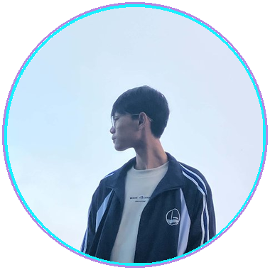

<div align="center">

  <!-- Dynamic Waving Header Banner -->
  

</div>

<!-- Hero Profile Header: Avatar + Intro + Social Badges -->
<table align="center" width="100%">
  <tr>
    <td align="center" valign="middle" width="165" style="border: none;">
      <a href="https://github.com/kenG-8">
        
      </a>
    </td>
    <td valign="middle" style="border: none;">
      <h1 style="border-bottom: none; margin-bottom: 2px;">Nguyễn Tất Trung 👋</h1>
      <p style="font-size: 16px; margin-top: 4px; margin-bottom: 8px;">
        🚀 <b>AI Engineer • ML Engineer • Data Analyst</b><br/>
        🎓 <i>Khoa Công nghệ Thông tin — Trường Đại học Công nghệ, ĐHQGHN (UET - VNU)</i>
      </p>
      <p>
        <a href="mailto:kengtop24@gmail.com" target="_blank">
          
        </a>
        <a href="https://x.com/imissher61" target="_blank">
          
        </a>
        <a href="https://www.instagram.com/trungg.24/" target="_blank">
          
        </a>
        <a href="https://github.com/kenG-8" target="_blank">
          
        </a>
      </p>
    </td>
  </tr>
</table>

<div align="center">

  <!-- Live Visitor Counter & Status Badges -->
  <p align="center">
    
    
    
  </p>

  <!-- High-Tech Neon Typing SVG -->
  <a href="https://github.com/kenG-8">
    
  </a>

  <br/>

  <!-- GitHub Achievement Trophies -->
  

</div>

---

### 💫 Về bản thân (Terminal View)

```bash
kenG-8@uet:~$ neofetch --profile
```

```yaml
  👤 Identity   : Nguyễn Tất Trung (TrungG)
  🎓 Education  : Trường Đại học Công nghệ – ĐHQGHN (UET - VNU)
  🏛️ Faculty    : Khoa Công nghệ Thông tin (CS / IT)
  🎯 Focus      : AI Engineer | ML Engineer | Data Analyst
  🚀 Superpower : C++ • Python • Rust • High-Speed Data Pipelines
  💡 Philosophy : "Write clean algorithms, optimize model latency, let data tell the story."
  📫 Contact    : kengtop24@gmail.com
```

<details>
  <summary><b>🔍 Bấm để mở rộng: Định hướng nghiên cứu & Mục tiêu công việc (Click to expand)</b></summary>
  <br/>

  - 🤖 **Machine Learning & Deep Learning:** Nghiên cứu kiến trúc neural network, xử lý dữ liệu lớn (Big Data) và tối ưu hóa inference latency.
  - 📈 **Data Analytics & Visualization:** Sử dụng Pandas, NumPy và SQL để phân tích chuyên sâu các tập dữ liệu thực tế, xây dựng báo cáo & dashboard trực quan.
  - ⚙️ **Systems & Optimization:** Ứng dụng C++ và Rust để xử lý các thuật toán nặng, tối ưu hóa bộ nhớ và tốc độ thực thi.
  - 💼 **Mục tiêu:** Tìm kiếm cơ hội thực tập / Fresher tại các công ty công nghệ trong các dự án AI, Khoa học dữ liệu hoặc Kỹ thuật phần mềm hiệu năng cao.
</details>

---

### 🛠️ Kỹ năng & Vũ khí công nghệ (Tech Stack)

<div align="center">

  <!-- Animated Skill Icons Strip -->
  <a href="https://skillicons.dev">
    
  </a>

</div>

<br/>

<table>
  <tr>
    <td width="33%" align="center"><b>💻 Programming Languages</b></td>
    <td width="33%" align="center"><b>🧠 AI, ML & Data Analytics</b></td>
    <td width="33%" align="center"><b>🗄️ Database & Environment</b></td>
  </tr>
  <tr>
    <td valign="top">
      <br/>
      <br/>
      <br/>
      <br/>
      
    </td>
    <td valign="top">
      <br/>
      <br/>
      <br/>
      <br/>
      
    </td>
    <td valign="top">
      <br/>
      <br/>
      <br/>
      <br/>
      
    </td>
  </tr>
</table>

---

### 🔥 Dự án nổi bật (Featured Projects)

<p align="center">
  <a href="https://github.com/kenG-8/downloaded-music">
    
  </a>
  <a href="https://github.com/kenG-8/photobooth">
    
  </a>
</p>

<table>
  <tr>
    <td width="50%">
      <b>🎵 <a href="https://github.com/kenG-8/downloaded-music">downloaded-music</a></b>
      <p>Hệ thống tự động tải, phân loại và chuyển đổi nhạc đa định dạng chất lượng cao với tốc độ nhanh và giao diện thân thiện.</p>
      <code>Python</code> • <code>Audio Stream</code> • <code>Automation</code>
    </td>
    <td width="50%">
      <b>📸 <a href="https://github.com/kenG-8/photobooth">photobooth</a></b>
      <p>Ứng dụng chụp ảnh phong cách photobooth tương tác trực tiếp với webcam, tích hợp hiệu ứng, filters và lưu kỷ niệm sắc nét.</p>
      <code>JavaScript</code> • <code>WebCam API</code> • <code>Interactive UI</code>
    </td>
  </tr>
</table>

---

### 📊 Thống kê hoạt động (GitHub Telemetry)

<div align="center">

  <!-- Interactive Activity Graph -->
  

  <br/><br/>

  <!-- GitHub Stats & Top Languages -->
  
  

  <br/><br/>

  <!-- Streak Stats Card -->
  

</div>

---

### ⚡ Interactive Corner: Random Dev Thought

<div align="center">
  
</div>

<br/>

<div align="center">
  
</div>
